# Hi 👋, I'm Nalin Angrish

**Systems software built close to the metal, with zero room for failure.**

I'm a systems software engineer working across low-latency distributed systems, autonomous cloud and datacenter operations, and real-time robotics. I care about the architectural decisions that don't show up in the diff but determine whether a system holds together under pressure.

- **Most recently:** SDE Intern at **Nava** — worked on the intelligence platform for autonomous cloud and datacenter operations: Graph-RAG retrieval, an agentic reasoning harness, GPU-cluster simulation for LLM inference, and observability pipelines.
- **Previously:** Research Intern at **IISc Bengaluru (RBCCPS, FOCAS Lab)** — built distributed real-time control for multi-UAV swarms on ROS2, including a Control Barrier Function safety layer for collision avoidance and geofencing.
- **Education:** B.Tech at **IIT Ropar** ('23–'27).
- **Leadership:** Previously Secretary of the Aeromodelling Club and Software Community Representative at IIT Ropar, and Deputy Contingent Leader for Inter IIT Tech Meet 14.0.
- **Open to:** high-impact systems engineering roles and collaborations.

## 🚀 What I work on

- **Systems & infrastructure** — C++ daemons, Unix IPC, Linux runtime internals, GPU memory enforcement with NVML, systemd
- **Cloud & distributed systems** — Go/Python services, gRPC, Graph-RAG, agentic reasoning harnesses, observability pipelines
- **AI infrastructure** — GPU-cluster simulation, vLLM/SGLang inference configs, local LLM tooling, MCP
- **Robotics & control** — ROS2, PX4/MAVLink, Control Barrier Functions, fault-tolerant flight, multi-UAV swarms

## 🔧 Selected projects

| Project | What it does | Stack |
| --- | --- | --- |
| **[GPUMan](https://www.nalinangrish.me/projects/gpuman)** | Per-process GPU VRAM governor that terminates runaway CUDA workloads before system-wide OOMs — no MIG required. | C++, NVML, Unix sockets, systemd · [code](https://github.com/Nalin-Angrish/GPUMan) |
| **[Cloud Manager](https://www.nalinangrish.me/projects/cloudmanager)** | Natural-language cloud automation: LLM-parsed prompts executed through an MCP tool server with execution logs and live state. | Python, FastAPI, Next.js, Docker, Ollama · [code](https://github.com/Nalin-Angrish/CM) |
| **[FlexNN](https://www.nalinangrish.me/projects/flexnn)** | Zero-dependency C++ neural network library with Eigen3 SIMD and OpenMP parallelism; 95%+ MNIST accuracy. | C++17, Eigen3, OpenMP, CMake · [code](https://github.com/Nalin-Angrish/FlexNN) |
| **[Luna](https://www.nalinangrish.me/projects/luna)** | Raspberry Pi powered robotic quadruped with custom chassis, 12-servo actuation, and ROS2 vision-based navigation. | Python, ROS2, Raspberry Pi, Computer Vision · [code](https://github.com/Nalin-Angrish/Luna) |
| **[Fault-Tolerant Quadrotor](https://www.nalinangrish.me/projects/ftc-of-quadrotor-with-single-motor-failure)** | qLPV observer detects single-motor failure in ~417 ms; SE(3) controller keeps the drone stable post-failure. | C++, PX4, Gazebo SITL, ROS2, Control Theory · [code](https://github.com/Nalin-Angrish/PX4-Autopilot-InterIIT) |

More at [nalinangrish.me/projects](https://www.nalinangrish.me/projects).

## 💻 Tech stack

## 🌐 Socials

---

**Beyond the terminal:** guitar, sport, and books. Always up for a good conversation about systems, startups, or an album recommendation — [say hello](mailto:nalin@nalinangrish.me).

## 📊 GitHub stats

  
  
   
  

